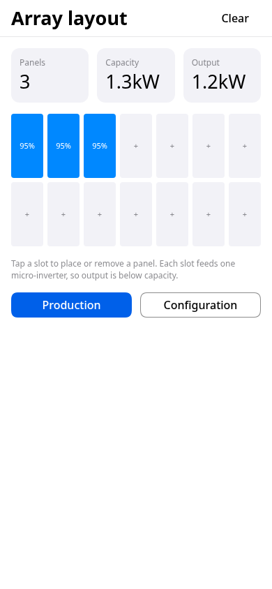
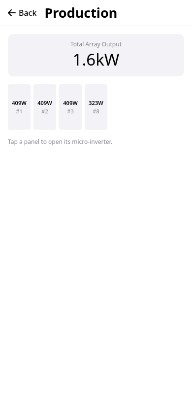
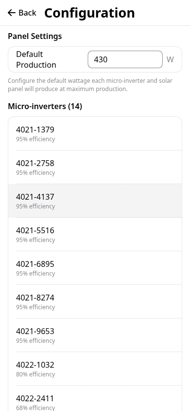
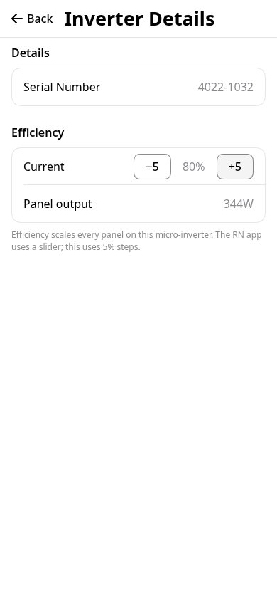

# exact-solar-array-trial

**Live demo:** https://benjaminkomen.github.io/exact-solar-array-trial/

A trial of [Exact](https://github.com/expo/exact), Expo's pre-alpha Rust app framework. It ports four screens of [solar-array-simulator](https://github.com/benjaminkomen/solar-array-simulator) so the two can be compared side by side. It runs on the web only and is an experiment, not a full port.

## Screens

| Exact screen | RN source | Ported | Missing or replaced |
|---|---|---|---|
| Array layout | `src/app/custom.tsx` (`SolarPanelCanvas`, `useCanvasEditor`) | Placing and removing panels, live panel count, capacity and output | Drag, rotate, snap, collision and zoom are replaced by a fixed 7×2 grid of tap-to-toggle slots, one per micro-inverter. No Skia canvas. |
| Production | `src/app/production.tsx` (`useProductionMonitor`, `ProductionCanvas`) | Total Array Output card, per-panel wattage, tap a panel to open its inverter | No canvas, compass or zoom. Output is static: the 1 s refresh and ±5% noise are left out. No Simulate (3D) screen and no Edit/Delete menu. |
| Configuration | `src/app/config.tsx` (`useConfigForm`, `InverterSection`) | Default Production wattage (parsed and clamped as in `updateDefaultWattage`), micro-inverter list with serial and efficiency | No location search (it needs a geocoding API), no roof type or tilt, no add, delete or swipe, and no wizard mode. |
| Inverter Details | `src/app/inverter-details.tsx` (`InverterDetailsForm`) | Serial, efficiency, resulting panel output | The efficiency slider is replaced by ±5% buttons. The serial number can't be edited. |

Skipped:
- Welcome (`index.tsx`).
- Upload and analysis (`upload.tsx`, `analyze.tsx`): they use the camera, an image picker and an AI API.
- Simulation (`simulation.tsx`): it's a three.js 3D scene.
- Compass help.
- Panel details sheet.

**Real data and math:**
- `defaultMaxWattage` is 430 W.
- The 14 default inverters keep their efficiencies: seven at 95%, then 75, 68, 62, 20, 15, 0 and 0%. These all come from `DEFAULT_CONFIG` in `src/utils/configStore.ts`.
- Per-panel output is `getEffectiveOutput`'s formula when no location is set (`maxWattage × efficiency / 100`), with the noise left out and rounded as `useProductionMonitor` does.
- Wattage is formatted with a port of `formatWattage`.
- Serial numbers are fixed stand-ins, because Exact sources may not use randomness.
- The config lives in memory rather than in kv-store.

| Array layout | Production | Configuration | Inverter Details |
|---|---|---|---|
|  |  |  |  |

The screenshots come from `bun exact.mjs agent web --size 390x844`.

## Files

- `app.contract`: the view, routes, state and actions, written in Exact's Contract language. The screens form one stack: layout → production or configuration → inverter.
- `app.ts`: the data module. It holds the config and handles the `setWattage` and `setEfficiency` mutations.
- `app.test.contract`: three tests, one per screen, that check both navigation and the totals.
- `scripts/deploy-pages.sh`: builds the app and publishes it to the `gh-pages` branch.

## Running it

This app uses an Exact checkout by path. By default that's `../exact`; set `EXACT2` to point at another location. Use the Rust, Bun and Chrome versions your Exact checkout pins. Its README and `bun scripts/exact.mjs setup --check` list them.

```sh
git clone https://github.com/expo/exact.git
git clone https://github.com/benjaminkomen/exact-solar-array-trial.git
(cd exact && bun scripts/exact.mjs setup)
cd exact-solar-array-trial
bun exact.mjs web            # dev loop in the browser
bun exact.mjs test web       # runs app.test.contract
bun exact.mjs agent web "tap open-production" "screenshot out.png"
```

Exact is pre-alpha and changes daily. If a command fails, `bun exact.mjs update` refreshes the generated files against your checkout.

## Deploying the demo

`scripts/deploy-pages.sh` builds the static site with `bun exact.mjs web-build --out dist` and force-pushes it to the `gh-pages` branch. GitHub Pages serves it from a subpath, so the script points `<base href>` at `/exact-solar-array-trial/`. It also copies `index.html` to `404.html`, so that reloading a pushed screen still loads the app.

Exact's router has no base path, and a trailing slash matches no route. To work around that:
- every route in `app.contract` sits under `/exact-solar-array-trial`;
- a `notfound` route catches `/` and the trailing-slash URL, then steps back to the layout.

## License

MIT
