# exact-solar-array-trial

**Live demo:** https://benjaminkomen.github.io/exact-solar-array-trial/

A trial of [Exact](https://github.com/expo/exact), Expo's pre-alpha Rust app framework. It ports the main screens of [solar-array-simulator](https://github.com/benjaminkomen/solar-array-simulator) and tries to match them as closely as Exact allows. The live demo is a web build. An unsigned iOS build is produced in GitHub Actions (see below); EAS Build does not support Exact yet.

The panel art follows the RN app's `BasePanelShape`, `SolarPanel` and `ProductionPanel` and is drawn in SVG:
- a 60 × 120 panel with an 8-point corner radius and a 2-point frame;
- one centre line and three cross lines;
- the theme's linked (blue) and unlinked (grey) colours;
- a 3-point amber ring when the panel is selected;
- a dark wattage label on Production.

The RN code has no gradient or sheen, so this doesn't either.

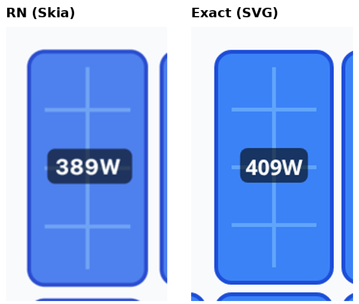

## The flow

It follows the RN app's wizard: **Welcome → Get Started → Configure → Continue → Photo → Skip (or Continue without photo) → Layout → Finish → Production**. Back steps through the stack, as in the RN app. From Production, the ⋯ menu has Edit Configuration (the wizard again from step 1) and Delete Configuration (which resets everything and goes back to Welcome).

| Exact screen | RN source | Matches | Still different |
|---|---|---|---|
| Welcome | `index.tsx` | The 140-point icon tile with its blue glow, the title, the subtitle, and the Get Started button. | No status bar or iOS chrome. The RN app skips to Production on launch once the wizard is done; here state lives in memory, so every load starts at Welcome. |
| Wizard stepper | `WizardProgress.tsx` | Shown on Configure, Photo and Layout. 32-point circles: blue with a check when done, blue with the number when current, and grey-ringed when ahead. The 11-point labels and the 40 × 2 connectors also match. | None that matters. |
| Configure | `config.tsx?wizard=true` | Step 1, with the floating Continue and + bottom bar. | The Location (city) section isn't ported. The navigation bar is the web host's, with a large left-aligned title and a "Back" text. |
| Photo | `upload.tsx` | Step 2: the icon tile, title, subtitle, Take Photo and Choose from Gallery, Continue without photo, and Skip. | The camera and gallery are disabled and labelled as not ported. Skip goes straight to an empty Layout, as in RN. Continue without photo goes to the mock 2 × 5 grid the RN Analyze step falls back to, but the Analyze screen itself isn't ported. |
| Layout Editor | `custom.tsx`, `SolarPanelCanvas`, `CustomChrome`, `ZoomControls` | Step 3. The header has the compass toggle, the unlinked-count badge and Snap to origin. Drag a panel and it snaps on release to its neighbours or the 30-point grid, refusing a collision. Also: pan, zoom (200 ms ease-in-out quad, as in RN's `useZoom`), add, link, rotate and delete. Every new panel starts unlinked. Finish appears once there's at least one panel. | The bar is the web host's. The RN iOS title is empty; this uses the RN web title, "Layout Editor". |
| Compass | `Compass.tsx` | An 80-point compass with four 40° arcs, N, E, S and W (N darker), and the notched arrow. Drag the arrow: the angle is `atan2(dx, -dy)` from the centre and snaps to the nearest 45° on release, stored in `config.compassDirection`. A tap opens the help. The toggle shows it and opens the help, as in RN. Production shows it read-only. | The snap isn't animated over 150 ms. |
| Array Orientation sheet | `compass-help.tsx`, `CompassHelpBody` | The navigation arrow, the title and the real copy. | A full-height sheet with Close, not a 0.3-detent form sheet with a grabber. |
| Panel Details sheet | `panel-details.tsx`, `PanelDetailsForm` | Linked Inverter (serial, efficiency, Unlink) and Available Inverters, with the real footer copy. | A full-height sheet: Exact's web host has no detents. |
| Production | `production.tsx`, `ProductionCanvas`, `ProductionPanel` | The Total Array Output card and the canvas, centred on the panels, with per-panel wattage labels refreshed every second, the read-only compass, zoom, and the ⋯ menu. | No Simulate (sun) button; the 3D view isn't ported. Back goes to Welcome, because Finish rebuilds the stack. |
| Micro-inverter sheet | `inverter-details.tsx`, `InverterDetailsForm` | Edit and Add titles, the Serial Number field, Efficiency with a slider, and the real footer copy. | A full-height sheet. |

Skipped:
- the camera, gallery and AI analysis;
- the 3D simulation (three.js);
- the location search.

**Side by side, the wizard and compass** (left: the repo's iOS screenshots; right: this Exact web build at 390 × 844):

| | |
|---|---|
| 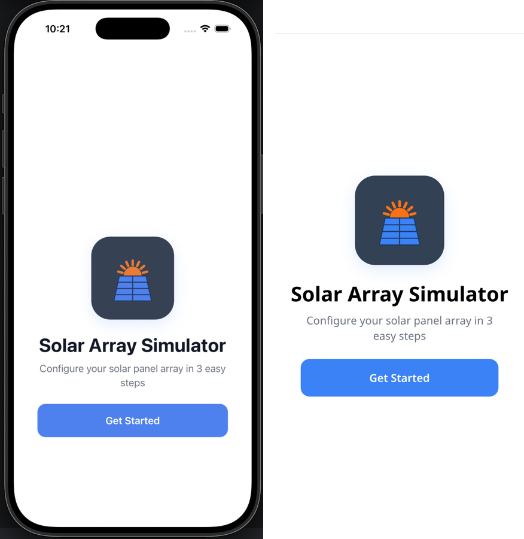 | 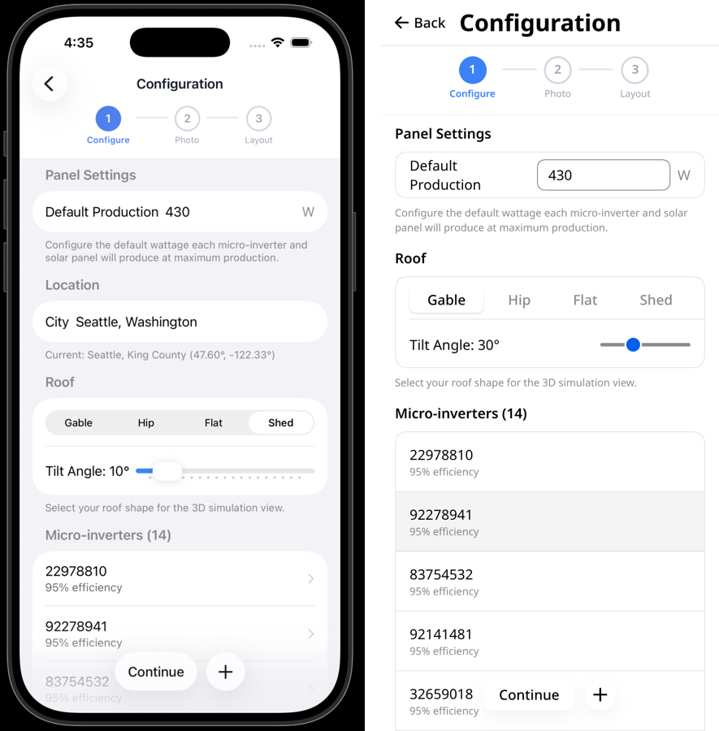 |
|  | 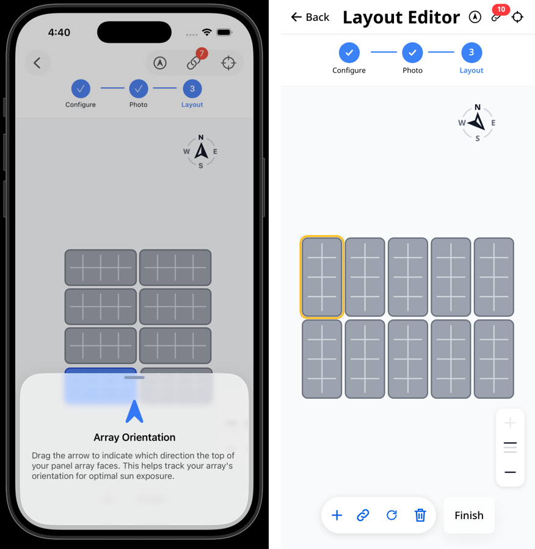 |

**Data:**
- All numbers come from the repo: `defaultMaxWattage` 430 W, the 14 default inverter efficiencies, panel size and gap, grid and snap threshold, zoom levels, and the panel colours.
- The wizard starts the way the RN app does: no panels after Skip, or `buildMockPanelGrid`'s 2 × 5 grid after Continue without photo. Every panel is unlinked until you link it.
- Serial numbers are fixed, because the repo generates them randomly.
- Everything is kept in memory.

**Side by side, the editor screens** (left: the repo's iOS screenshots; right: the live Exact web build at 390 × 844):

| | |
|---|---|
| 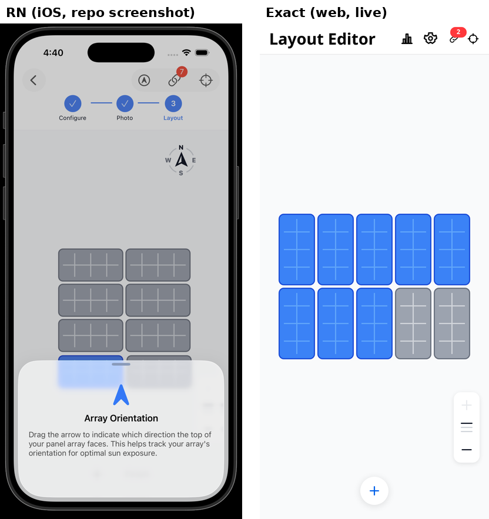 | 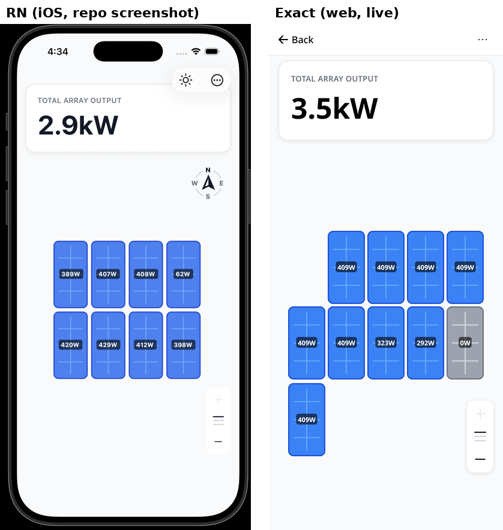 |
| 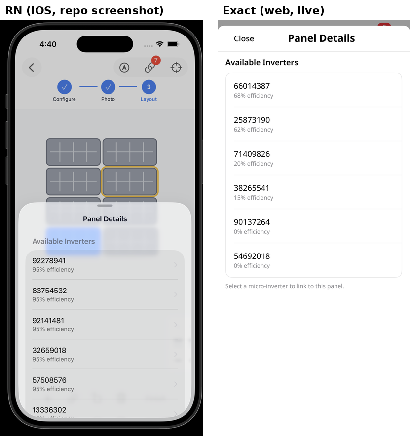 | 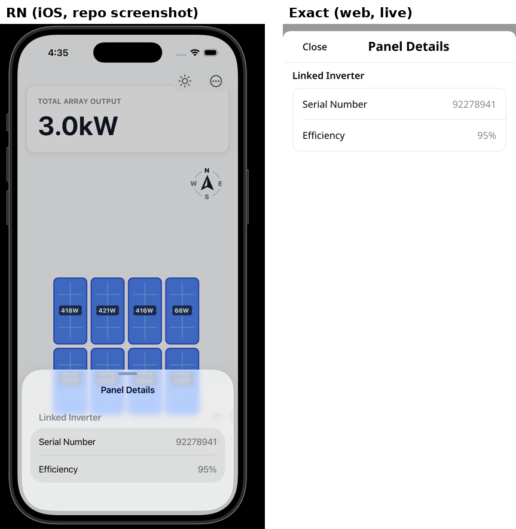 |
| 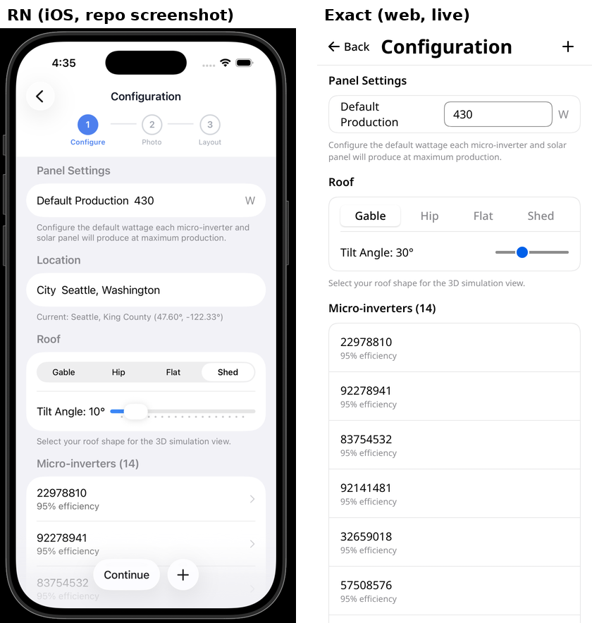 | 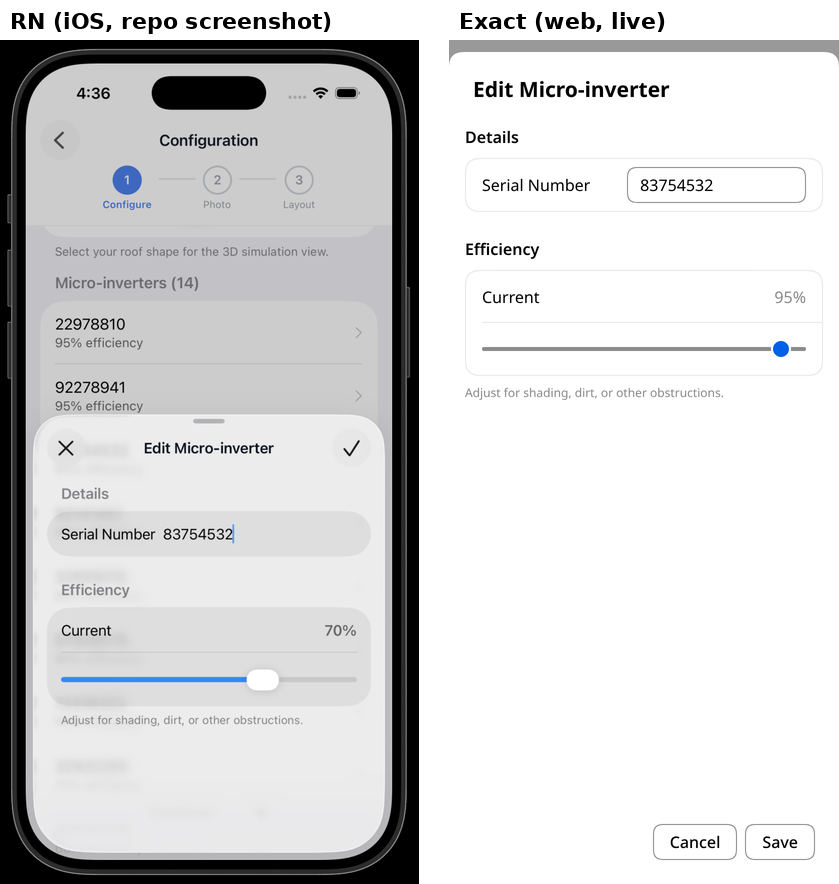 |

## 3D simulation: two spikes

Production's **Simulate** button opens the RN Simulation screen (`simulation.tsx`): total output, the time, the sunrise-to-sunset hour slider and the season chips. A picker at the top switches between two renderers of the same scene: the sky, the ground, the grey roof slab tilted by the configured tilt, your layout's panels as blue boxes, and the sun. The hour and season logic (`solarCalculations.ts`, `getVisualSunPosition`, `computePanelLayout`, the output with tilt and compass direction) is `simulate` in `app.ts`. Both spikes draw from its result.

Live: [three.js iframe](https://benjaminkomen.github.io/exact-solar-array-trial/production/simulate?engine=three) and [wgpu module](https://benjaminkomen.github.io/exact-solar-array-trial/production/simulate?engine=gpu). Opening those links directly starts at Welcome, since state lives in memory, so go through the wizard to Production first.

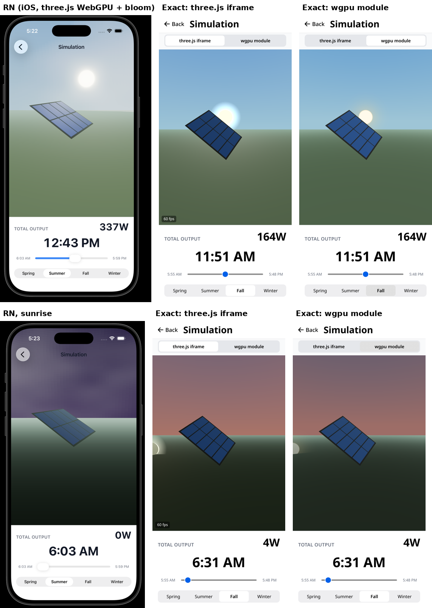

| | three.js iframe (`assets/sim3d/`) | wgpu GPU module (`gpu/`) |
|---|---|---|
| How it works | A standalone page with plain three.js 0.172 (the RN app's version) and the WebGL renderer, in Exact's `iframe`. The guest posts `ready`, then the app sends the scene string with `postMessage(text, "sim3d")`, and a keyed task resends it whenever it changes. | A Rust `Surface` (`roof`) on `exact-gpu`, placed with `canvas surface=roof(...)`. The scene arrives as the canvas's arguments. It has three small pipelines (the sky gradient, lit cubes, the sun's glow) with 4x MSAA and a depth buffer. |
| Code | `main.js` 149 lines, `index.html` 13, plus the vendored three.js | `roof.rs` 368, `roof.wgsl` 136, `lib.rs` 33, a 55-line native test, plus a Cargo workspace (`Cargo.toml`, `web/`, `apple/`), because an app with a GPU module has to author one |
| Shared | `app.ts` +71 lines (`simulate`), `app.contract` +97 (the screen) | the same |
| Download (gzip) | three.js 175 KB + `main.js` 3 KB | `gpu_bg.wasm` 132 KB + glue about 45 KB + shader 2 KB |
| Draws | Every display frame, like R3F (about 60 fps on the box's software GPU) | Only when an argument changes |
| Looks | Closest to RN: real three.js lights, fog and sky dome. The glow sprite stands in for RN's bloom pass. | Close, with Lambert lighting, exponential fog and a sky gradient. No clouds or bloom. |
| Without the GPU API | Needs WebGL, which every browser has | Needs WebGPU. Without it the app shows a "needs WebGPU" note under the empty canvas. |
| iOS | Bundled: a page under `assets/` loads from the app in a web view (LLP 1020.001), so it works offline. It's a WKWebView with WebGL inside the native app. | The idiomatic path: the same Rust renders on Metal. It's packaged by the iOS archive like Caltrain's module. Not built on iOS yet. |

Neither has orbit or shadows, and RN has neither. Clouds aren't ported in either spike.

## Files

- `app.contract`: the views, routes, state and actions, written in Exact's Contract language. `PanelArt` draws a panel, `ZoomControls` is the zoom card, `WizardProgress` is the stepper and `CompassRose` is the compass.
- `app.ts`: the data module, holding the config and panels. Snap, collision, free-position, rotation and output logic are ported from the repo's `utils/`.
- `assets/sim3d/`: the three.js spike's iframe page, with three.js 0.172 vendored (MIT, `THREE-LICENSE`).
- `gpu/`: the wgpu spike, a GPU module crate with the `roof` surface, its WGSL and a native readback test (`cargo test -p exact-solar-trial-gpu`). `Cargo.toml`, `web/` and `apple/` make up the app's own Cargo workspace, which a GPU module needs.
- `app.test.contract`: six tests. They cover the whole wizard (Welcome → Configure → Skip → Layout → Finish → Production), the photo-less grid with drag, rotate, zoom and link, a compass drag that sets `config.compassDirection` to 90° then 180°, Production's menu back into Configuration, zoom easing through intermediate scales over 200 ms, and the Simulation screen (the hour and season move the time, and the engine picker swaps the iframe for the GPU canvas).
- `scripts/deploy-pages.sh`: builds the app and publishes it to the `gh-pages` branch.

## Running it

This app uses an Exact checkout by path. By default that's `../exact`; set `EXACT2` to point at another location. Use the Rust, Bun and Chrome versions your Exact checkout pins. Its README and `bun scripts/exact.mjs setup --check` list them.

```sh
git clone https://github.com/expo/exact.git
git clone https://github.com/benjaminkomen/exact-solar-array-trial.git
(cd exact && bun scripts/exact.mjs setup)
cd exact-solar-array-trial
bun exact.mjs web            # dev loop in the browser
bun exact.mjs test web       # runs app.test.contract
bun exact.mjs agent web "tap get-started-button" "clock settle" "screenshot out.png"
```

The native GPU test needs a Vulkan driver. On a Linux box without one, Chrome's bundled SwiftShader works: `VK_ICD_FILENAMES=/opt/google/chrome/vk_swiftshader_icd.json LD_LIBRARY_PATH=/opt/google/chrome cargo test -p exact-solar-trial-gpu`. Headless Chrome draws the wgpu canvas only with `--enable-unsafe-webgpu --use-webgpu-adapter=swiftshader --use-vulkan=swiftshader --enable-features=Vulkan,WebGPUSwiftShader`. Without those flags the device is lost after the first frames.

Exact is pre-alpha and changes daily. If a command fails, `bun exact.mjs update` refreshes the generated files against your checkout.

Cursor cloud agents use [`.cursor/environment.json`](.cursor/environment.json). Its install script clones the Exact commit pinned in [`.exact-ref`](.exact-ref) beside this repo, installs the Rust, Bun and Chrome that checkout requires, fetches the attested Hermes bundles and Cargo crates, and warms `bun exact.mjs test web` so `target/` is already built. A later run skips work that is already present. Feedback uploads stay off.

## Deploying the demo

`scripts/deploy-pages.sh` builds the static site with `bun exact.mjs web-build --out dist` and force-pushes it to the `gh-pages` branch. GitHub Pages serves it from a subpath, so the script points `<base href>` at `/exact-solar-array-trial/`. It also copies `index.html` to `404.html`, so that reloading a pushed screen still loads the app.

Exact's router has no base path, and a trailing slash matches no route. To work around that:
- every route in `app.contract` sits under `/exact-solar-array-trial`;
- a `notfound` route catches `/` and the trailing-slash URL, then steps back to Welcome.

## iOS build (GitHub Actions)

Exact is not a React Native project. Its iOS app is built by Exact's own script (`bun exact.mjs ios`), which needs Rust, Bun and Xcode, so EAS Build's standard build does not apply. An experimental EAS custom build is described in the next section. This repo's main iOS build is a GitHub Actions workflow: [`.github/workflows/ios.yml`](.github/workflows/ios.yml), on GitHub's `xcode-27` runner. Exact's own CI uses `macos-26`, but that image's default Xcode cannot compile Exact's Swift host (it references APIs such as `UIArrangementViewController` that the older SDK does not include). Exact does not build iOS apps in its own CI.

The workflow checks out a pinned Exact commit (Exact is pre-alpha and changes daily), installs the Rust toolchain and iOS targets Exact pins, Bun, and the attested Hermes bundles Exact's README describes, then builds:

- an unsigned device `.ipa`, with `bun exact.mjs ios --device --archive ExactSolarTrial.ipa --unsigned`. Exact ad-hoc signs it with no profile and no team, for a service that re-signs it.
- an iOS Simulator `.app`, with `bun exact.mjs ios --no-install` (a compile check: it does not boot a simulator).

There are no Apple signing secrets, so the `.ipa` cannot be installed on a phone until it is re-signed. An iOS distribution build also needs a square raster of at least 512 px in `app.json`'s `icons` array, which Exact's docs describe; this repo ships `assets/icon-1024.png`. Run the workflow from the Actions tab, or it runs on pushes to `main` that touch the app sources. The artifacts are attached to the run.

The workflow does not run Exact's full `bun scripts/exact.mjs setup`, which also installs the web and game toolchain. It only installs what an iOS TypeScript app needs.

To build the same way on a Mac, with Exact checked out next to this repo:

```sh
bun exact.mjs ios --device --archive ExactSolarTrial.ipa --unsigned
bun exact.mjs ios --no-install
```

## iOS build (EAS, experimental)

EAS can build this Exact app as an [Expo Workflow](https://docs.expo.dev/eas/workflows/syntax/). The build is an EAS [custom build](https://docs.expo.dev/custom-builds/schema/) made of plain shell steps, the same recipe as the GitHub Actions workflow. It doesn't use `eas/build`, prebuild or the `expo` package. It is tried on a free Expo account (45-minute limit), and builds an App Store-signed `.ipa` for `com.bkomen.exact-solar-trial`, then uploads it to App Store Connect.

- [`.eas/workflows/ios.yml`](.eas/workflows/ios.yml) has two jobs:
  - `build_ios` is a `type: build` job (platform `ios`, profile `ios-exact`).
  - `submit_ios` is a `type: submit` job that `needs` the build and takes its `build_id`. It uploads the build to App Store Connect using the production submit profile.
  - The workflow has no trigger, so it only runs by hand.
- [`.eas/build/ios-exact.yml`](.eas/build/ios-exact.yml) is the custom build. It checks out the pinned Exact commit beside the app and installs rustup with the iOS targets (the image has Bun but no Rust). It then imports the EAS-managed distribution certificate and App Store profile (`eas.job.secrets.buildCredentials`) into a temporary keychain and installs the Hermes bundles. Finally it runs `bun exact.mjs ios --device --archive out.ipa` with `EXACT_IDENTITY` (the certificate's SHA-1) and `EXACT_PROFILE` (the profile's path), checks the signature with `codesign`, and uploads `out.ipa` as the build's application archive. `eas/configure_ios_credentials` can't be used, because it edits an Xcode project and Exact has none.
- [`eas.json`](eas.json) defines the profile `ios-exact`, on the `macos-tahoe-26.6-xcode-27.2` image with `store` distribution (EAS-managed credentials), plus an empty `production` submit profile.
- [`app.config.js`](app.config.js) gives EAS the Expo config it wants (name, slug, bundle id, project id). `app.json` belongs to Exact and has its own schema, so it stays untouched.

```sh
npx eas-cli@latest workflow:run .eas/workflows/ios.yml
```

What we found:

- **It's fast.** A cold build took 7 to 8 minutes on EAS's M4 Pro worker, against about 37 minutes cold on GitHub's `xcode-27` runner. The worker setup (Exact checkout, rustup, Hermes, crates) took about a minute, Rust about 330 s and Swift about 30 s. The `.ipa` was 15 MB and showed up as the build's downloadable artifact. As a workflow with the cache save, the whole run took about 10.5 minutes.
- **One workaround:** `eas build` and `eas workflow:run` resolve iOS entitlements locally and fail with "Cannot find 'expo-modules-autolinking' package in your project" when no Expo packages are installed. A devDependency on `expo-modules-autolinking` alone fixes that, without `expo` or React Native.
- **A harmless warning:** at the end of each build the worker logs "Failed to read the app config file with `expo config` command: The `expo` package was not found." under "Unknown build phase". The build still finishes and uploads the `.ipa`. We left it alone rather than add `expo`.
- **Caching works, but doesn't help yet.**
  - In a build job, `eas/save_build_cache` and `eas/restore_build_cache` only handle ccache and CocoaPods. They ignore `key` and `path`, and the step still reports success.
  - The generic `eas/save_cache` and `eas/restore_cache` take paths. They fail the whole save if one path is missing, so the build creates `~/.cache/exact` first.
  - The cache holds the app's `target/`, Exact's `target/`, the Hermes bundles and the Cargo registry. That is 1.3 GB compressed (about 4 GB on disk). Saving takes about 2 to 2.5 minutes, and restoring about 30 seconds.
  - The next run restored it, but Cargo still recompiled every crate (344 of them, including registry crates such as `proc-macro2`). The warm build took longer than the cold one: 11 minutes against 10.
  - The cause isn't known yet. One run with `CARGO_LOG=cargo::core::compiler::fingerprint=info` would show why Cargo treats the restored artifacts as stale. Until then, the cache costs about 3 minutes per run for no gain.

**Signing and submit work.** Build `3e8dd8fd` was signed with the iPhone Distribution identity (team 24L96WG9A8) and the EAS-managed App Store profile (no device list, `get-task-allow` false). An interactive `eas submit` uploaded it to App Store Connect, which also created the app record (6833494203, now in `eas.json`'s `production` submit profile). The workflow's `submit_ios` job is now on, so each run builds and then uploads with the API key stored on EAS.

**Build numbers** come from EAS remote versioning: `appVersionSource: "remote"` and `autoIncrement` on the `ios-exact` profile. EAS resolves the next number before the job starts. The custom build reads it as `${ eas.job.version.buildNumber }` and passes it to Exact as `EXACT_BUILD_NUMBER`, which Exact writes to `CFBundleVersion` in an `--archive` build (default `1`). `CFBundleShortVersionString` comes from `EXACT_VERSION` (default `0.1.0`). App Store Connect needs the build number to go up with every upload. The custom build calls `eas/install_node_modules` and `eas/resolve_build_config` first. A workflow build job only gets the credentials and the build number once eas-cli resolves them on the worker; an `eas build` from a laptop resolves them before uploading. Watch out: the first remote-versioned build only initializes the counter (to 1, which was already uploaded) and doesn't increment it. The counter is now 1, so the next build gets 2.

**Cache: off.** The steps that worked are kept, commented out, in `.eas/build/ios-exact.yml`, with notes on the likely cause: a freshly installed toolchain, or rustc, RUSTFLAGS or env differing between runs.

## License

MIT
