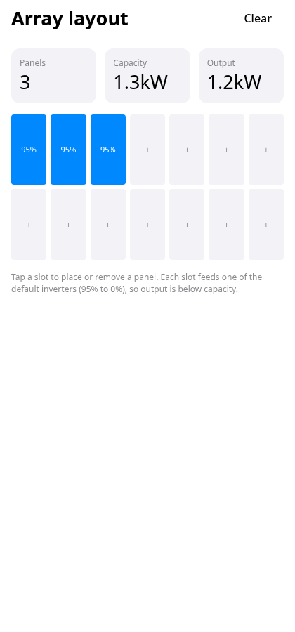
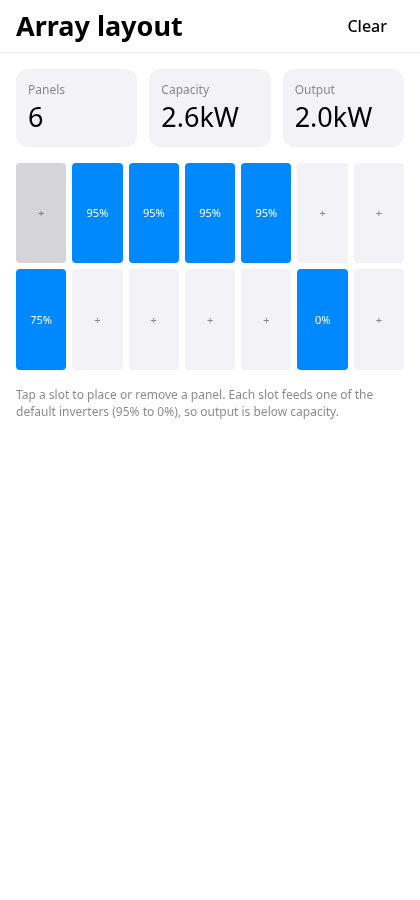

# exact-solar-array-trial

A small trial of [Exact](https://github.com/expo/exact), Expo's pre-alpha Rust app framework, using one slice of [solar-array-simulator](https://github.com/benjaminkomen/solar-array-simulator).

**Live demo:** https://benjaminkomen.github.io/exact-solar-array-trial/

It's an experiment, not a port. It has one screen, no persistence and no gestures.

## The slice

It ports the core of the array layout: a grid of panel slots you tap to place or remove a panel, with live totals.

- **Panels:** how many are placed.
- **Capacity:** panels × `defaultMaxWattage` (430 W, from `src/utils/configStore.ts`).
- **Output:** each placed panel's output, using `getEffectiveOutput`'s no-location formula from `src/utils/solarCalculations.ts` (`maxWattage × inverterEfficiency / 100`) without its ±5% random noise, rounded as `useProductionMonitor` does.

The 14 slots map one to one onto the 14 default inverters in `DEFAULT_CONFIG` (seven at 95%, then 75, 68, 62, 20, 15, 0 and 0%). That's why output stays below capacity. Totals are formatted with a port of `formatWattage` from `src/utils/formatters.ts`.

| Initial (3 panels) | After tapping slots 4, 5, 8 and 13 on, and 1 off |
|---|---|
|  |  |

Screenshots were taken on Exact's web host with `bun exact.mjs agent web`.

## Files

- `app.contract`: the view, state and actions, written in Exact's Contract language.
- `app.ts`: the data module, holding the panel wattage and inverter efficiencies.
- `app.test.contract`: one test that taps slots and checks the totals.
- `app.json`: the manifest, produced by `exact new`.

## Running it

This app uses an Exact checkout by path. By default that's `../exact`; set `EXACT2` to point at another location. Use the Rust, Bun and Chrome versions your Exact checkout pins. Its README and `bun scripts/exact.mjs setup --check` list them.

```sh
git clone https://github.com/expo/exact.git
git clone https://github.com/benjaminkomen/exact-solar-array-trial.git
(cd exact && bun scripts/exact.mjs setup)
cd exact-solar-array-trial
bun exact.mjs web            # dev loop in the browser
bun exact.mjs test web       # runs app.test.contract
bun exact.mjs agent web "tap slot-4" state "screenshot out.png"
```

Exact is pre-alpha and changes daily. If a command fails, `bun exact.mjs update` refreshes the generated files against your checkout.

## Deploying the demo

`scripts/deploy-pages.sh` builds the static site with `bun exact.mjs web-build --out dist` and force-pushes it to the `gh-pages` branch. GitHub Pages serves it from a subpath, so the script points `<base href>` at `/exact-solar-array-trial/`. The app's assets are relative, so that's all it needs.

Exact's router has no base path, and a trailing slash matches no route. `app.contract` therefore declares a `notfound` route that draws the same screen.

## License

MIT
